<!-- Profile README · header and stats are self-hosted; see .github/workflows/profile-assets.yml -->

<picture>
  <source media="(prefers-color-scheme: dark)" srcset="./assets/header-dark.svg">
  <source media="(prefers-color-scheme: light)" srcset="./assets/header-light.svg">
  
</picture>

  
  
  
  

[About](#-about) · [Featured work](#-featured-work) · [Experience](#-experience) · [Stack](#️-tech-stack) · [How I work](#-how-i-work) · [Activity](#-github-activity)

---

## 👋 About

I build practical AI and software systems — **AI agents, generative AI, NLP and LLMs, explainable ML, backend APIs and full-stack products** — and I care about making them **observable, testable, explainable and genuinely usable**, not just functional.

<table>
<tr>
<td width="50%" valign="top">

**🎓 Education**
- **MSc Artificial Intelligence with Industry** — University of Leicester, UK *(expected 2028)*
- **B.Tech CSE (AI & ML)** — Dayananda Sagar University · CGPA **8.31/10**

</td>
<td width="50%" valign="top">

**🔬 Current focus**
- Reliable, observable AI agents and developer tooling
- LLMs, NLP and generative AI
- Multimodal and explainable ML
- Turning research prototypes into products

</td>
</tr>
</table>

| **95.55%** | **15+** | **8.31 / 10** | **AWS ML** |
|:---:|:---:|:---:|:---:|
| GRU-based EEG emotion classification accuracy | AI, software and research projects | B.Tech CGPA | Certified Machine Learning — Specialty |

---

## 🚀 Featured work

<table>
<tr>
<td width="50%" valign="top">

### 🤖 Autonomous AI Coding Agent
Turns a GitHub issue into a proposed patch, validates it in an isolated Docker sandbox, and opens a draft PR — with a human reviewing every change.

`Python` `FastAPI` `LangGraph` `Docker`

[**Repository →**](https://github.com/Dinakarnayak/autonomous-ai-coding-agent)

</td>
<td width="50%" valign="top">

### 🔎 TraceLens · Agent Observability
Self-hostable workbench for inspecting agent traces, latency, errors, token usage and cost, with repeatable output evaluations.

`Python` `FastAPI` `SQLite` `Docker`

[**Repository →**](https://github.com/Dinakarnayak/tracelens-agent-observability)

</td>
</tr>
<tr>
<td width="50%" valign="top">

### ⚖️ PolicyGuard AI
Explainable privacy-policy and legal-risk analysis with clause-level evidence, calibrated confidence and a risk taxonomy.

`NLP` `Explainable AI` `Risk scoring`

[**Research notes →**](./profile/PROJECTS.md#policyguard-ai)

</td>
<td width="50%" valign="top">

### 🩺 MedFusion-X
Multimodal medical-AI research into adaptive fusion, modality disagreement, uncertainty estimation and when to abstain.

`Multimodal ML` `Uncertainty` `PyTorch`

[**Research notes →**](./profile/PROJECTS.md#medfusion-x)

</td>
</tr>
<tr>
<td width="50%" valign="top">

### 🛡️ Generative AI for Fraud Detection
GANs and VAEs for hard-to-detect fraud patterns, paired with XGBoost and SHAP so every decision stays explainable.

`GANs` `VAEs` `XGBoost` `SHAP`

[**Repository →**](https://github.com/Dinakarnayak/Generative-AI-for-Fraud)

</td>
<td width="50%" valign="top">

### 🎙️ Bunny Agent
FastAPI video agent for media processing, transcription, metadata generation and semantic search.

`FastAPI` `Whisper` `FFmpeg` `Pinecone`

[**Repository →**](https://github.com/Dinakarnayak/bunny_agent)

</td>
</tr>
</table>

**Also:** GenomeGuard · LinguaSpeak (speech recognition → translation → TTS) · TrustVote / Z-Vote · AI Task Web App · WorkForce API · EMS-Pro · Next Tech Platform — [browse all repositories →](https://github.com/Dinakarnayak?tab=repositories)

---

## 💼 Experience

| Role | Organisation | Period |
|---|---|---|
| **Founder** | Next Tech AI · Remote | Jan 2025 – Present |
| **Fulfillment Associate** | Amazon · UK | Jun 2026 – Sep 2026 |
| **Artificial Intelligence Engineer** | Wajooba · United States · Remote | Jan 2025 – Jul 2025 |

<b>Details</b>

 

- **Next Tech AI** — Building an early-stage AI and software venture: research, prototyping, product direction, UI/UX and iterative development.
- **Wajooba** — GPT-based course-content generation, NLP pipelines, LLM fine-tuning and deployment. *TypeScript · Pinecone*
- **Amazon UK** — Fast-paced fulfillment operations alongside continued AI/ML and software work.

---

## 🛠️ Tech stack

 Languages  

 AI / ML — plus LLMs, LangGraph, RAG, fine-tuning, SHAP / XAI  

 Backend &amp; frontend — REST, JWT, RBAC, TypeORM, Sequelize, Mongoose  

 Data, cloud, tooling &amp; design

---

## 🧭 How I work

**Problem → Baseline → Prototype → Evaluate → Secure → Deploy → Observe**

| Principle | In practice |
|---|---|
| **Evidence over demos** | Compare against meaningful baselines and run ablations to show which parts actually help. |
| **Know where it fails** | Report uncertainty and calibration, do error analysis, and let systems abstain when evidence conflicts. |
| **Observable by default** | Traces, logs and repeatable evaluations for every AI workflow. |
| **Reproducible** | Versioned data, configs, seeds and evaluation scripts. |
| **Secure & responsible** | Auth, RBAC, input validation, privacy-aware design and documented limitations. |
| **Human-centred** | Interfaces that make complex AI behaviour understandable and accessible. |

📚 More in my [research methodology](./profile/research-methodology.md) and [project research index](./profile/PROJECTS.md).

---

## 🏆 Certifications

AWS Certified Machine Learning — Specialty · ServiceNow Certified Application Developer · ServiceNow Certified System Administrator · Certified Ethical Hacker · Statistics for R · Java Database Connectivity (JDBC) · Cybersecurity · Computer-Aided Design (CAD)

---

## 📊 GitHub activity

<picture>
  <source media="(prefers-color-scheme: dark)" srcset="https://raw.githubusercontent.com/Dinakarnayak/Dinakarnayak/output/stats-dark.svg">
  <source media="(prefers-color-scheme: light)" srcset="https://raw.githubusercontent.com/Dinakarnayak/Dinakarnayak/output/stats-light.svg">
  
</picture>

<picture>
  <source media="(prefers-color-scheme: dark)" srcset="https://raw.githubusercontent.com/Dinakarnayak/Dinakarnayak/output/github-contribution-grid-snake-dark.svg">
  <source media="(prefers-color-scheme: light)" srcset="https://raw.githubusercontent.com/Dinakarnayak/Dinakarnayak/output/github-contribution-grid-snake.svg">
  
</picture>

Generated daily by GitHub Actions in this repository.

---

**Open to AI/ML engineering roles, research collaborations and interesting builds.**

[Portfolio](https://dinakarnayak.github.io/Portfolio/) · [LinkedIn](https://www.linkedin.com/in/dinakar-nayak-n-125762232/) · [dinakarnayak4248@gmail.com](mailto:dinakarnayak4248@gmail.com)

Leicester, UK

